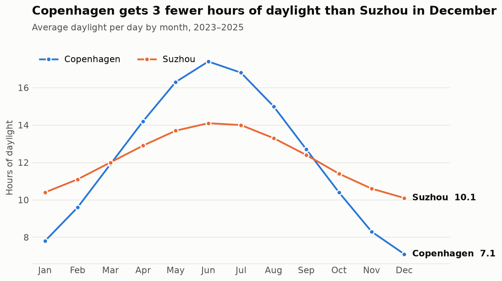
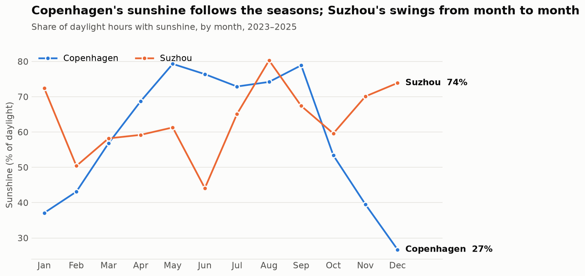

# How dark is a Copenhagen winter? Copenhagen vs Suzhou

I studied in Suzhou and moved to Copenhagen in 2026 for my MSc. This small project uses three years of daily weather data to compare daylight, sunshine and temperature in the two cities.

## Questions

1. How many hours of daylight does each city get in each month?
2. How many days a year does Copenhagen have less than 8 hours of daylight?
3. Which month is the darkest and coldest in each city?
4. How much of the daylight is actual sunshine?

## How it works

1. Python pulls daily data for 2023–2025 from the [Open-Meteo Historical Weather API](https://open-meteo.com/en/docs/historical-weather-api).
2. pandas cleans the data and converts durations to hours.
3. The data is stored in a SQLite database (`weather.db`).
4. SQL queries answer the questions; the main query is checked against a pandas `groupby`.
5. Matplotlib draws the charts.

## Findings

- In December, Copenhagen gets only about 7 hours of daylight a day, around 3 hours less than Suzhou.
- Copenhagen has about 62 days a year with less than 8 hours of daylight; Suzhou has none.
- In both cities the coldest month (January) comes one month after the darkest (December).
- In January the two cities are only 2.5°C apart, but Copenhagen has 2.6 fewer hours of daylight. Compared with Suzhou, a Copenhagen winter is mainly dark rather than cold.
- Clouds make it darker still: only 27% of Copenhagen's December daylight is sunny. Copenhagen's sunshine follows the seasons, while Suzhou's changes from month to month and drops to 44% in June, during the plum rain season.





## Limitations

Open-Meteo's sunshine duration is estimated by a weather model, not measured at a station, so the sunshine figures are approximate.

## Tools

Python · requests · pandas · SQLite / SQL · Matplotlib · Jupyter

## Run it yourself

```
pip install requests pandas matplotlib
jupyter notebook analysis.ipynb
```
